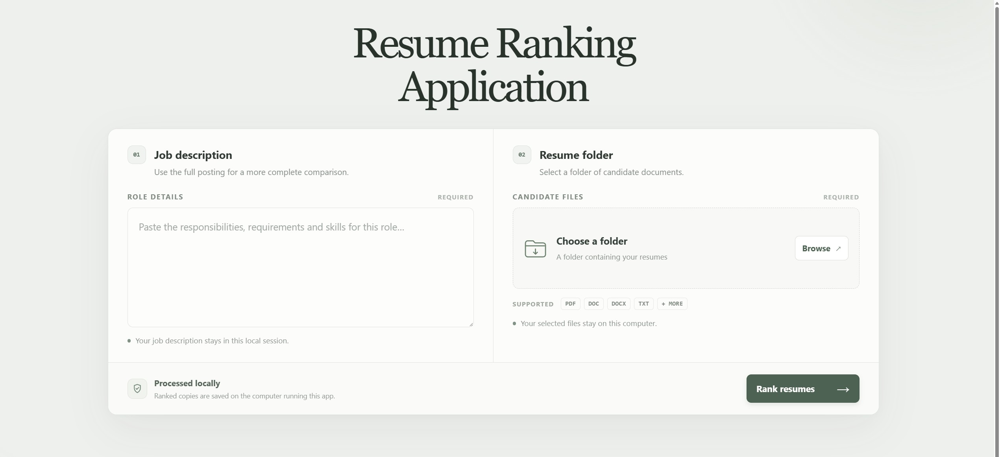
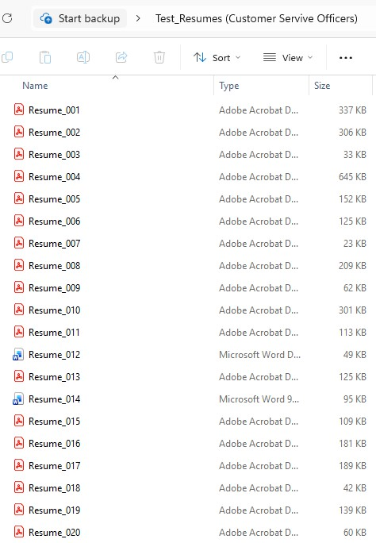
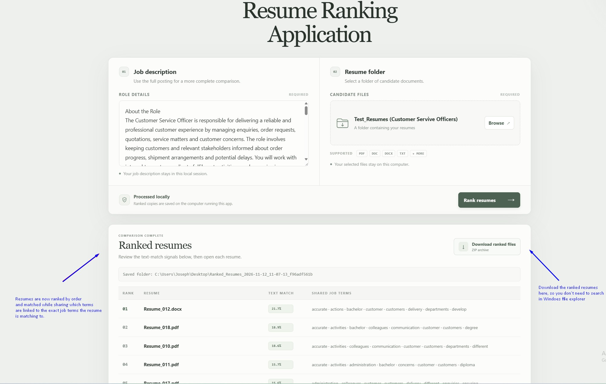
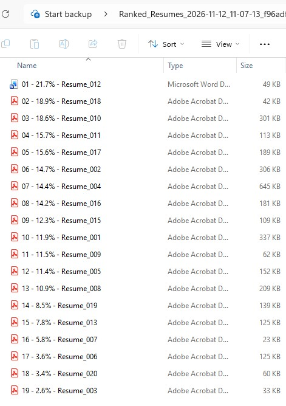

# Resume_Ranking_Web_Application
Mass hiring is a time-intensive function for Recruiters as 1000s of CVs need to be vetted, coupled with administrative overload this becomes inefficient,  this app's main goal is to ingest a folder of resumes and rank order in terms of relevance to the role, helping to focus the Recruiter's limited time to the most relevant CVs

The aim of the project is to dramaticaly shorten the Recruiter's time taken to open, read/vet, qualify candidates who apply for a job, Recruiters are currently opening applicant's resume one-by-one in the ATS which is ranked by the date of applicaiton, it's inefficient and highly dependent on the Recruiter's duration of focus while other urgent tasks takes his/her time away. 

The application extracts text from candidate resumes, compares them against a job description and generates a ranked list based on text similarity and keyword coverage.

### How to run this locally 

1. In VScode, cloe this repository from github 
2. Create a virtual environment:
    python -m venv .venv 
3. Activate the environment:
    .venv\Scripts\Activate.ps1 
4. Install dependencies:
    python -m pip install -r requirements.txt 
5. Start the application:
    python main.py 
6. Open in your browser (no internet is needed)
    http://127.0.0.1:5000 
7. Paste your job description into the box 
8. Select the folder containing your resumes (100mb limit)
9. Click Rank Resumes 
10. Resumes are now ranked based on relevance to the JD and downloadabe in a ZIP file (on desktop)

### How TF-IDF Cosine Similarity works 

There's a YT video online that explains this quite well here: https://youtu.be/x1u5TotQ0G0?si=sgv6Ok9Hc7vnL7D-

The general idea is to remove letters/words that deliver little to no meaning to the Recruiter and we extract the remaining text locally, it applies TF-IDF cosine similarity (70%) with the JD term coverage of (30%). Scores are text-based only they do not establish qualification, performance, suitability, cultural-fit, in other words this is NOT a replacement for the Recruiter's human judgement, it simply pair's an applicant's Resume to the JD and ranks it in terms of relevance.
Everything is done locally there's no AI or internet needed to run this so Resumes are safe within the company's / Recruiter's control. 

## Demonstration of the project 

Upon step 6, you should see this in your browser. Once here copy and paste your Job Description to the right and open the folder containing your Resumes on the left.

**We will use this JD to test :**

## Customer Service Officer -- Test Job Description

#### About the Role

The Customer Service Officer is responsible for delivering a reliable
and professional customer experience by managing enquiries, order
requests, quotations, service matters and customer concerns. The role
involves keeping customers and relevant stakeholders informed about
order progress, shipment arrangements and potential delays. You will
work with internal teams to coordinate fulfilment activities, resolve
service issues and maintain effective customer relationships.

#### Key Responsibilities
- Respond promptly and professionally to customer enquiries, orders,
  quotation requests and service-related matters.
- Manage customer concerns and escalations, ensuring that issues are
  followed through to resolution.
- Provide regular updates on order progress, shipment schedules,
  potential risks and recommended actions to customers and management.
- Liaise with internal departments to coordinate order processing,
  delivery arrangements and issue resolution.
- Develop and maintain positive working relationships with customers,
  colleagues and senior stakeholders.
- Prepare and maintain accurate customer documentation, reports and
  operational records.
- Follow company procedures, customer requirements, quality guidelines
  and applicable regulatory standards.

#### About You
- Diploma or bachelor's degree in Business Administration,
  Engineering, Operations Management or a related discipline.
- At least three years of experience in a customer service or customer
  support position.
- Strong customer service orientation, with clear written and verbal
  communication skills.
- Able to work independently, take initiative and resolve problems
  effectively.
- Confident in handling challenging situations, managing conflicts and
  working with different stakeholders.
- Well organised, able to prioritise competing tasks and manage time
  in a busy working environment.
- Self-motivated, detail-oriented and comfortable working with
  operational information and reports.

---

**Sample File with test Resumes (Currently unranked and no order)** 

This file of resumes are then parsed into the applicaiton to be ranked, note as of right now they are orderd based on applicaiton datetime, and in real-life you will have 100s or 1000s of such resumes that need to be reviewed. 

--- 

**Ranked Resumes**

After running the application you will receive the same Resumes but now with their TF-IDF ranking and which key words in the JD that their resumes are matching to, 
you can then export it as a zip file (default destination is your desktop) and you can view them in a ranked order now with the most suitable candidate at the top. 

--- 

**Results after ranking (in desktop, Ranked with Order)**

You can now view the resumes in ranked order back in your dekstop, the candidate that is the most suitable are now at the top!. 

# Final Note 

- Note this method cannot replace Human Judgment, or an experienced Recruiter's discernment for cultural fit, motivation and purpose this tool is meant to help you not replace your selection criterial and intuition. 
- Since the main value add of this tool is fast and mass ordering of resumes it's best used in roles that are highly fixed, structured and replicable in their job dutites such as: 
    - Customer Service Officers, Maintenance Technicians, Drivers, Service Staff etc. 
- The application still does not accept all file formats so it's possible certain Resumes with older file formats might not get parsed, i've added an error message at the bottom that points these out in the applicaiton 
- This project is free for use, feel free to drop a star or message me if you'd like a demonstration. 

Cheers! 
